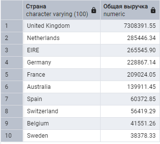
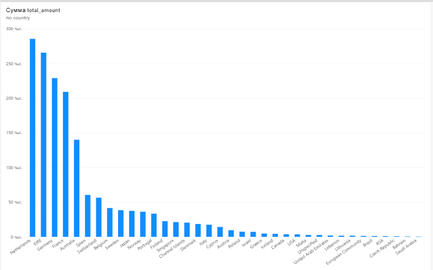
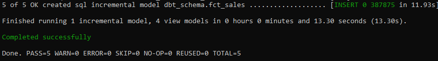

# DWH Marketplace Analytics

Проект по построению корпоративного хранилища данных (DWH) для e-commerce.

## 🏗 Архитектура хранилища (Схема Звезда)

В основе проекта лежит модель данных «Звезда» (Star Schema), состоящая из одной таблицы фактов и трех таблиц измерений. Это позволяет аналитикам писать быстрые запросы для расчета бизнес-метрик.

*   **`fact_sales`** — таблица фактов (транзакции: количество, цена, сумма).
*   **`dim_customers`** — измерение «Клиенты» (ID клиента, страна).
*   **`dim_products`** — измерение «Товары» (Артикул, описание).
*   **`dim_dates`** — измерение «Даты» (Год, месяц, день).

## ⚙️ ETL-процесс
Данные загружаются из сырого CSV-файла (397 924 строки) с помощью Python-скрипта (`etl_star_schema.py`). Скрипт очищает данные от возвратов и пустых значений, после чего раскладывает их по таблицам DWH в PostgreSQL.

## 🚀 Ключевые результаты
*   Загружено и обработано **397 924** строк транзакций.
*   Спроектирована модель DWH с разделением на Fact/Dim.
*   **Оптимизация SQL:** Проведен анализ плана запросов (EXPLAIN ANALYZE). Созданы индексы, позволившие ускорить агрегационные запросы в 6 раз (с 6.3 сек до 0.9 сек).

## 📊 Результаты работы

Пример аналитического запроса к модели «Звезда» — выручка по странам:

## 📈 Визуализация (Power BI)

## 🛠 Технологии
*   **Python** (Pandas, SQLAlchemy) — для ETL.
*   **PostgreSQL** — как база данных хранилища.
*   **SQL** — для аналитических запросов и оптимизации.
*   **Power BI** — для визуализации.

## 🗂 Data Governance (Каталогизация данных)

В проекте реализован элемент управления метаданными (Data Governance). Скрипт `catalog_generator.py` автоматически подключается к DWH, анализирует структуру таблиц (`information_schema`) и генерирует **Data Catalog** в формате JSON.

Это позволяет:
*   Автоматически отслеживать изменения схемы данных.
*   Хранить документацию по каждой таблице и колонке.
*   Использовать каталог для дальнейшей интеграции с инструментами Data Lineage.

Пример сгенерированного каталога доступен в файле [`data_catalog.json`](data_catalog.json).

## ⚙️ Оркестрация (Apache Airflow)

Для автоматизации ETL-процесса развернут **Apache Airflow** (через Docker Compose). 

Настроен DAG (`marketplace_dwh_etl_pipeline`), который ежедневно запускает скрипт загрузки данных в DWH. Успешное выполнение задачи подтверждено в веб-интерфейсе.

## ⚡ Бенчмарк: PostgreSQL vs ClickHouse

В рамках развития проекта я провел сравнение скорости агрегационных запросов в двух СУБД на одном и том же датасете.

**Условия:**
*   **PostgreSQL:** 397 924 строки (после очистки данных).
*   **ClickHouse:** 531 285 строк (загружено «как есть», без агрессивной очистки).
*   **Запрос:** `GROUP BY` с суммированием выручки и сортировкой (топ-10).

| СУБД | Время выполнения (среднее из 3 запусков) |
|---|---|
| PostgreSQL | 0.5244 сек |
| ClickHouse | 0.0774 сек |
| **Ускорение** | **6.8x** |

**Вывод:** ClickHouse показал ускорение в **6.8 раз**, несмотря на то, что объем данных был на 33% больше. Это подтверждает эффективность колоночных OLAP-СУБД для аналитических задач. PostgreSQL остается оптимальным выбором для транзакционных нагрузок (OLTP).

## 🧱 Трансформация данных (dbt)

В проект интегрирован **dbt (data build tool)** для организации слоя трансформаций (ELT) поверх готового DWH.

**Реализованные модели:**
- `stg_sales` (staging) — очистка и подготовка данных из `fact_sales`.
- `dim_products`, `dim_customers`, `dim_dates` (marts) — измерения для модели «Звезда».
- `fct_sales` (marts) — **инкрементальная** витрина продаж (выручка и количество по чекам и товарам).

**Тестирование и качество данных:**
- Настроены тесты `not_null` для ключевых полей (`invoice_no`, `stock_code`, `total_revenue`).
- Настроены тесты `relationships` для проверки ссылочной целостности:
  - `fct_sales.stock_code` → `dim_products.stock_code`
  - `fct_sales.customer_id` → `dim_customers.customer_id`
  - `fct_sales.order_date` → `dim_dates.date_id`

**Результат:** все тесты проходят (PASS=5), данные в витрине консистентны.

**Стек dbt:**
- `dbt-core` 1.12.6, `dbt-postgres` 1.11.0.
- Модели собираются в схеме `dbt_schema` базы `dwh_marketplace`.

### Сборка инкрементальной модели

### Прохождение тестов (not_null + relationships)

