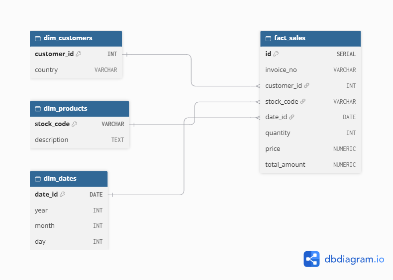

# DWH Marketplace Analytics

Проект по построению корпоративного хранилища данных (DWH) для e-commerce.

## 🏗 Архитектура хранилища (Схема Звезда)

В основе проекта лежит модель данных «Звезда» (Star Schema), состоящая из одной таблицы фактов и трех таблиц измерений. Это позволяет аналитикам писать быстрые запросы для расчета бизнес-метрик.

*   **`fact_sales`** — таблица фактов (транзакции: количество, цена, сумма).
*   **`dim_customers`** — измерение «Клиенты» (ID клиента, страна).
*   **`dim_products`** — измерение «Товары» (Артикул, описание).
*   **`dim_dates`** — измерение «Даты» (Год, месяц, день).

## ⚙️ ETL-процесс
Данные загружаются из сырого CSV-файла (397 924 строки) с помощью Python-скрипта (`etl_star_schema.py`). Скрипт очищает данные от возвратов и пустых значений, после чего раскладывает их по таблицам DWH в PostgreSQL.

## 🚀 Ключевые результаты
*   Загружено и обработано **397 924** строк транзакций.
*   Спроектирована модель DWH с разделением на Fact/Dim.
*   **Оптимизация SQL:** Проведен анализ плана запросов (EXPLAIN ANALYZE). Созданы индексы, позволившие ускорить агрегационные запросы в 6 раз (с 6.3 сек до 0.9 сек).

## 🛠 Технологии
*   **Python** (Pandas, SQLAlchemy) — для ETL.
*   **PostgreSQL** — как база данных хранилища.
*   **SQL** — для аналитических запросов и оптимизации.
*   **Metabase** *(в процессе настройки)* — для визуализации.