# DWH Marketplace Analytics

**Pet-проект** по построению корпоративного хранилища данных (DWH) для e-commerce на реальном датасете (397 924 строки). Демонстрирует полный цикл: от ETL и оркестрации до трансформаций, тестов и аналитики.

**Ключевые навыки:** SQL, Python (Pandas, SQLAlchemy), PostgreSQL, Apache Airflow, dbt, ClickHouse, Data Quality (Great Expectations), Data Vault 2.0.

---

## 🏗 Архитектура хранилища (Схема Звезда)

В основе проекта лежит модель данных «Звезда» (Star Schema), состоящая из одной таблицы фактов и трех таблиц измерений.

- **`fact_sales`** — таблица фактов (транзакции: количество, цена, сумма).
- **`dim_customers`** — измерение «Клиенты» (ID клиента, страна).
- **`dim_products`** — измерение «Товары» (Артикул, описание).
- **`dim_dates`** — измерение «Даты» (Год, месяц, день).

## ⚙️ ETL-процесс и Оркестрация (Apache Airflow)

Данные загружаются из сырого CSV-файла (397 924 строки) с помощью Python-скрипта (`etl_star_schema.py`). Скрипт очищает данные от возвратов и пустых значений, после чего раскладывает их по таблицам DWH в PostgreSQL.

Для автоматизации развернут **Apache Airflow** (Docker Compose). Настроен DAG (`marketplace_dwh_etl_pipeline`), который ежедневно запускает скрипт загрузки.

**DAG включает:**
- `wait_for_etl_script` (FileSensor) — ожидает появления ETL-скрипта.
- `run_etl_script` (BashOperator) — запускает ETL.
- `notify_success` (BashOperator) — уведомляет об успехе.
- `BranchPythonOperator` — выбирает ветку выполнения (ETL или уведомление об ошибке).
- `TaskGroup` — группирует задачи ETL.

Настроены `retries` (3 попытки, экспоненциальный backoff) и `catchup=True` (backfill).

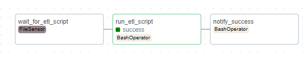
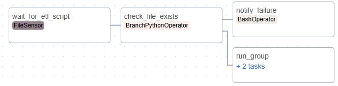

## 🧱 Трансформация данных (dbt)

В проект интегрирован **dbt** для организации слоя трансформаций (ELT) поверх готового DWH.

**Реализованные модели:**
- `stg_sales` (staging) — очистка и подготовка данных из `fact_sales`.
- `dim_products`, `dim_customers`, `dim_dates` (marts) — измерения для модели «Звезда».
- `fct_sales` (marts) — **инкрементальная** витрина продаж.

**Тестирование и качество данных (dbt):**
- Тесты `not_null` для ключевых полей (`invoice_no`, `stock_code`, `total_revenue`).
- Тесты `relationships` для ссылочной целостности (`fct_sales` → `dim_products`, `dim_customers`, `dim_dates`).

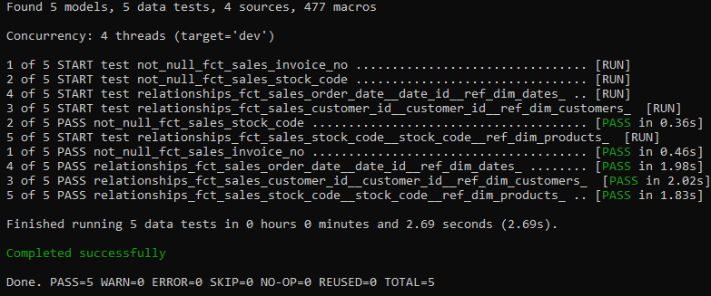

**SCD Type 2 (dbt snapshot):**
Настроен снапшот `dim_customers_snapshot` (стратегия `check` по колонке `country`). dbt отслеживает изменения страны клиента и сохраняет историю (SCD Type 2).

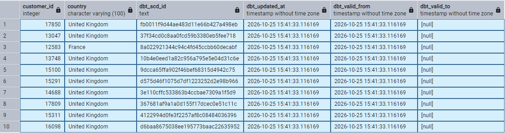

**Data Lineage (dbt):**
Скрипт `lineage_graph.py` парсит `manifest.json` из dbt и строит граф зависимостей между моделями (через `networkx` и `matplotlib`).

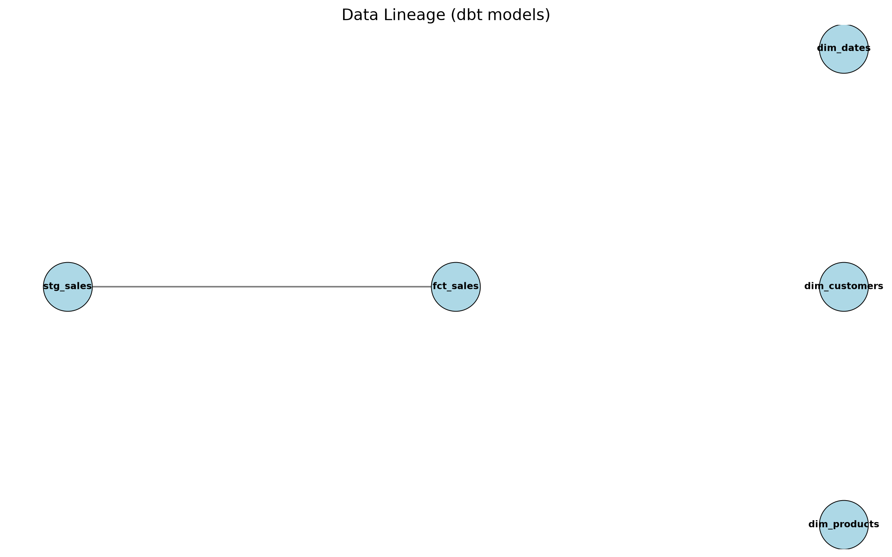

*Примечание: Граф отражает только те зависимости, которые dbt видит в SQL-коде. Измерения присоединяются на уровне BI или витрин.*

## 🗄 Data Vault 2.0 (Альтернативная архитектура DWH)

Помимо классической модели «Звезда», в проекте реализована модель **Data Vault 2.0** (в отдельной схеме `data_vault`).

**Что реализовано:**
- **Hub (Хаб):** `hub_customer` — уникальные бизнес-ключи клиентов.
- **Link (Линк):** `link_order_customer` — связи между заказами и клиентами.
- **Satellite (Сателлит):** `sat_customer_details` — атрибуты клиента с историей изменений (через `hashdiff` и `load_date`).

**ER-диаграмма:**

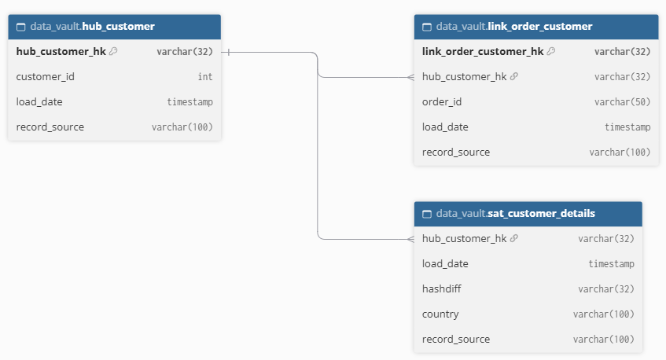

## 🗂 Metadata Management (Data Catalog)

В проекте реализован легковесный каталог данных (альтернатива тяжелым enterprise-решениям типа OpenMetadata/DataHub).

**Как это работает:**
- Python-скрипт `catalog_generator.py` парсит `manifest.json` из dbt (Lineage) и собирает метаданные из `information_schema` PostgreSQL.
- Все данные сохраняются в отдельную схему `metadata_catalog.tables_metadata`.

**Скриншоты:**

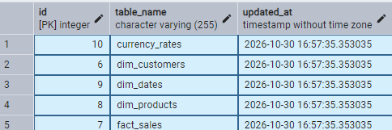
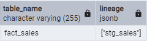

## 🛡 Data Quality & Drift Monitoring (Great Expectations + Metabase)

В проекте реализован мониторинг качества данных на базе **Great Expectations** с визуализацией в **Metabase**.

**Что сделано:**
- Настроены проверки (`data_quality_checks.py`): отсутствие NULL в ключевых полях (`total_revenue`, `invoice_no`, `stock_code`), отсутствие отрицательных значений в `total_revenue`.
- Реализована проверка **Data Drift**: сравнение текущего среднего значения `total_revenue` с эталонным (отклонение > 10% считается аномалией).
- Результаты всех проверок сохраняются в БД в схему `metadata_catalog.data_quality_results`.
- Построен дашборд в Metabase: «Data Quality Status» (круговая диаграмма) и «Data Drift Monitor» (таблица с отклонениями).

**Кастомные проверки (углубление):**
- Уникальность комбинации `invoice_no + stock_code` (в одном чеке не должно быть дублей товара).
- Соответствие формата даты (`order_date`) регулярному выражению `YYYY-MM-DD`.
- Отсутствие аномалий в `total_revenue` (сумма не должна превышать 100 000 за строку).

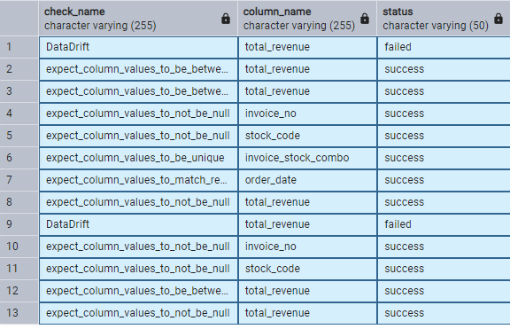

**Скриншот дашборда:**

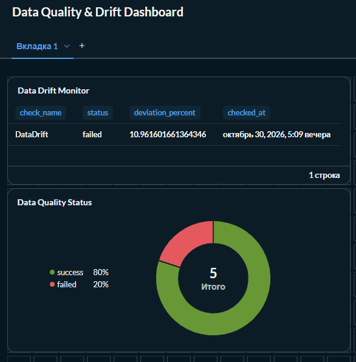
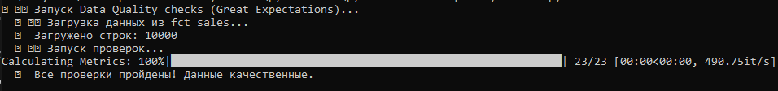

## 📊 Визуализация (BI)

На основе витрины `fct_sales` (dbt-модель) построены дашборды в четырех BI-инструментах.

**Power BI:**

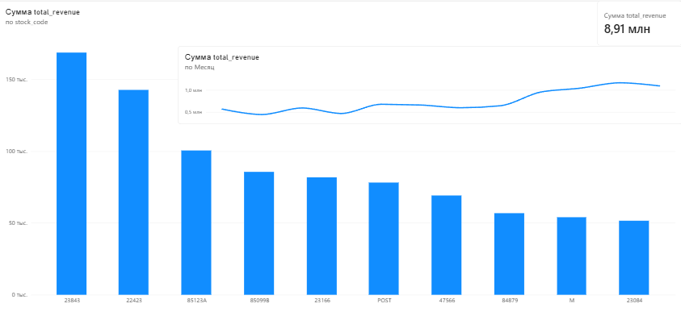

**Metabase:**

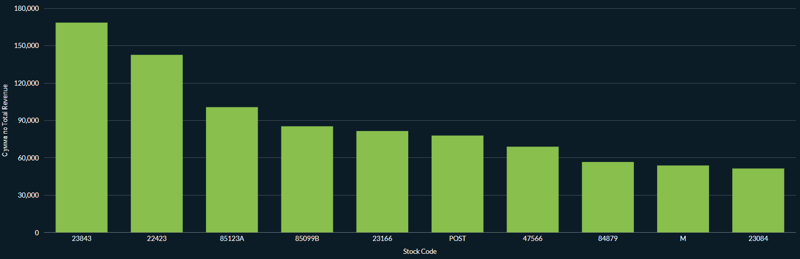

**Apache Superset:**

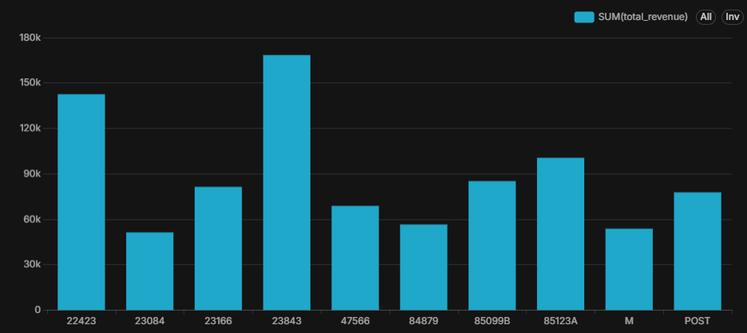

**Yandex DataLens:**

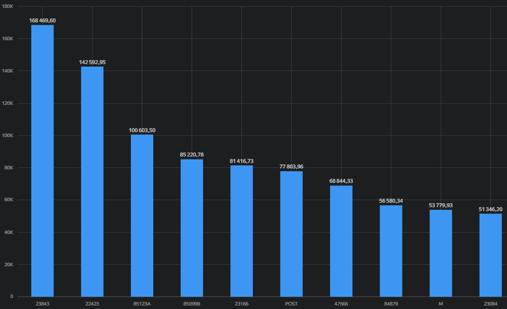

### 🛡 Безопасность и управление доступом (RLS)

В проекте настроен механизм **Row-Level Security (RLS)** в Apache Superset. Это позволяет ограничивать доступ к данным на уровне строк в зависимости от роли пользователя.

**Пример реализации:**
- Создана роль `Germany_Viewer`.
- Создано правило RLS: `stock_code = '23843'` для датасета `fct_sales`.
- Пользователь с этой ролью видит только данные, соответствующие фильтру (один товар).

  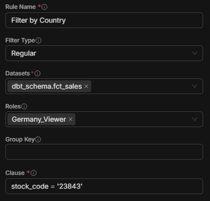
  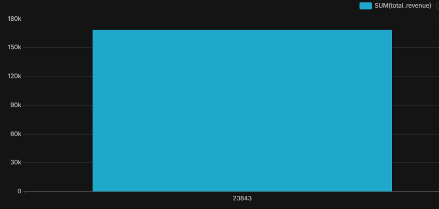

## 🏎 Продвинутая работа с ClickHouse

Помимо бенчмарка (PostgreSQL vs ClickHouse — ускорение 6.8x), были отработаны продвинутые механизмы:

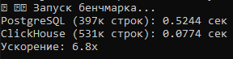

- **Партиционирование** (`MergeTree`, `PARTITION BY toYYYYMM(event_date)`).
- **TTL** — автоматическое удаление устаревших данных (старше 30 дней).
- **Materialized View** (`SummingMergeTree`) — предагрегация данных при вставке.

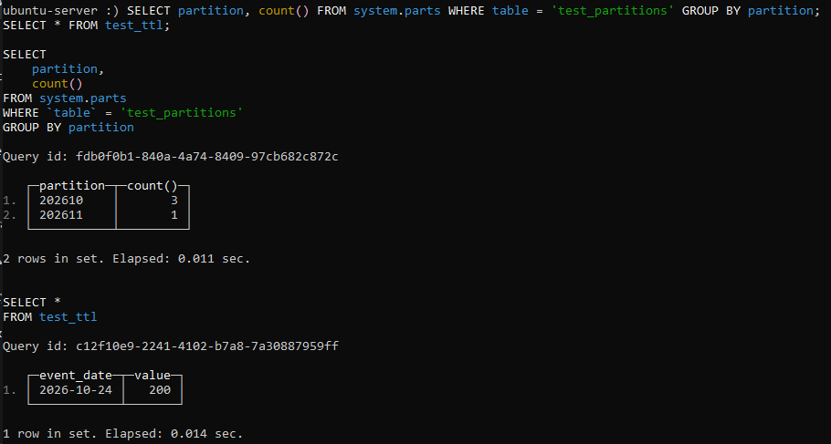

---

## 🧪 Дополнительные эксперименты (Pet-исследования)

Эти разделы не входят в основной DWH-пайплайн, но демонстрируют широту навыков.

### 🔄 CDC (Change Data Capture) 
Настроена логическая репликация PostgreSQL (`wal_level = logical`, публикация `sales_pub`, слот `sales_slot`). Python-скрипт ловит изменения в `fct_sales` в реальном времени.

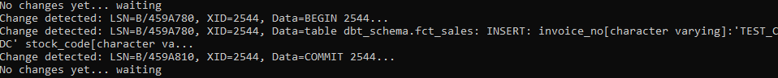

### ⚡ PySpark 
Практический опыт анализа данных в Google Colab (DataFrame API, агрегации, сортировка). Пример: топ-10 товаров по выручке.

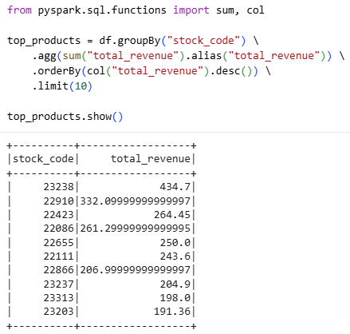

### 🧊 Lakehouse (Apache Iceberg)

Реализован pet-пример работы с **Apache Iceberg** (формат таблиц поверх Parquet):
- Создана Iceberg-таблица `demo.test_iceberg` (каталог SQLite, данные в Parquet).
- Записаны и прочитаны данные (3 строки).
- Показана история таблицы (snapshots).

Скрипт: `iceberg_demo.py`. Демонстрирует понимание Lakehouse (ACID-транзакции, time travel, schema evolution).

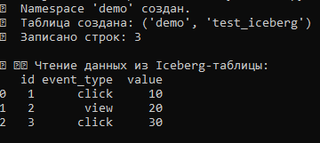

### 🦆 DuckDB + Parquet Analytics

Мини-проект по аналитике Parquet через DuckDB (без ETL). CSV → Parquet, сжатие в 11,4 раза. Вынесен в отдельный репозиторий: [duckdb-parquet-analytics](https://github.com/nconichtchenko-arch/duckdb-parquet-analytics).

---

## 🛠 Технологии

- **Python** (Pandas, SQLAlchemy) — ETL и обработка данных.
- **PostgreSQL** — основная база данных хранилища.
- **SQL** — аналитические запросы и оптимизация (EXPLAIN ANALYZE).
- **Apache Airflow** — оркестрация ETL-пайплайна (Docker).
- **dbt** — трансформация данных (ELT), тесты и Lineage.
- **ClickHouse** — колоночная OLAP-СУБД для аналитики.
- **Docker** — контейнеризация (Airflow, ClickHouse, Metabase).
- **BI-инструменты** (Power BI, Metabase, Apache Superset, Yandex DataLens) — визуализация данных.
- **Great Expectations** — тестирование качества данных.
- **Data Vault 2.0** — архитектурный паттерн для Enterprise DWH.
- **PySpark** — анализ данных в Google Colab.
- **Kafka** — потоковая передача данных (CDC).

## 📫 Контакты

- **Email:** pavloni@mail.ru
- **GitHub:** [github.com/nconichtchenko-arch](https://github.com/nconichtchenko-arch)
- **Проживание:** Воронеж
- **Формат работы:** удалённо
